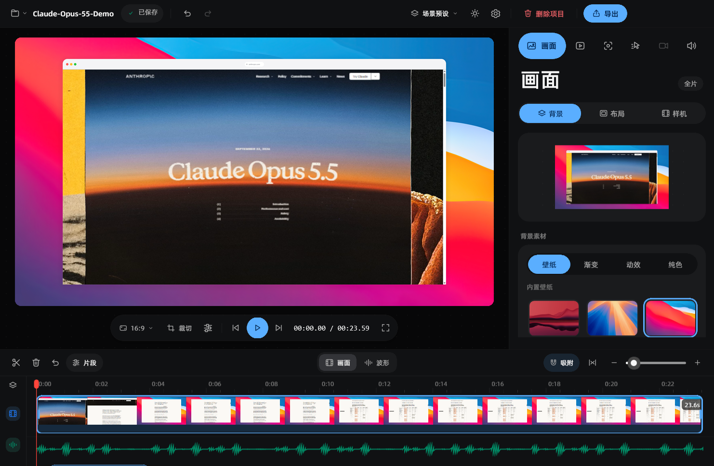
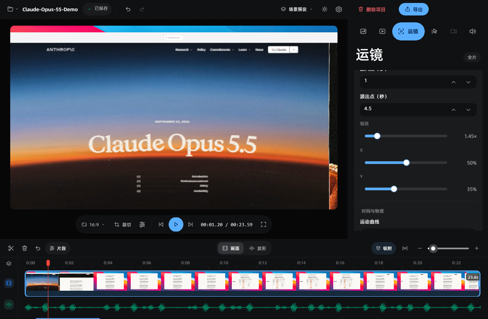

<p align="center">
  
</p>

<h1 align="center">FrameTrail</h1>

<p align="center">
  <b>录得清楚，剪得轻松，运镜自然。</b><br>
  Windows 11 原生的录屏、AI 智能剪辑与演示视频编辑工具。
</p>

<p align="center">
  
  
  
  
</p>

<p align="center">
  <a href="https://github.com/lucasx001/frametrail/releases/latest"><b>下载安装包</b></a>
  &nbsp;·&nbsp;
  <a href="#从源码构建">从源码构建</a>
  &nbsp;·&nbsp;
  <a href="https://github.com/lucasx001/frametrail/issues">反馈问题</a>
</p>

<p align="center">
  
</p>

## 功能

<table>
  <tr>
    <td width="50%" valign="top">
      <b>录制</b><br>
      显示器、窗口、自定义区域，或用 USB 数据线连接的 Android 手机。同步录制摄像头、麦克风和系统声音（支持按应用采集），内置圆形悬浮倒计时与悬浮备忘录提词器。
    </td>
    <td width="50%" valign="top">
      <b>导入与剪辑</b><br>
      无需录屏也可直接拖入或导入 <code>MP4 / MOV / M4V</code> 视频新建项目或合并片段。支持分割、裁剪、重排、<code>0.25–4×</code> 变速与恢复；缩略图胶片与音频波形随时切换，时间线边界自动吸附，支持悬停静音预览与进度条拖拽。
    </td>
  </tr>
  <tr>
    <td valign="top">
      <b>运镜与转场</b><br>
      点击自动跟随光标缩放与手动运镜；屏幕 3D 倾斜、透视与聚焦虚化；屏幕与摄像头开场动效；以及 8 种 GPU 渲染片段间转场（叠化、黑场／白场过渡、左右推进、左右擦除、缩放过渡）。
    </td>
    <td valign="top">
      <b>画面与样式</b><br>
      比例、画布直接裁切、留白、圆角、阴影、18 张内置壁纸／渐变／纯色／视频背景，以及无边框、macOS 窗口、浏览器与自适应设备样机外框；贴图、隐私打码遮挡与跨工程场景预设。
    </td>
  </tr>
  <tr>
    <td valign="top">
      <b>AI 剪辑助手</b><br>
      编辑器内置可折叠 AI 侧边栏，支持 <b>Review 预览确认</b>与 <b>Auto 自动应用</b>（所有修改均可 <code>Ctrl+Z</code> 一键撤销）。支持自然语言剪辑、斜杠命令（如 <code>/polish</code> 一键口播精剪、<code>/silence</code> 清理静音、<code>/clicks</code> 点击放大、<code>/portrait</code> 9:16 竖屏）、语音输入指令与多模态关键帧画面识别。
    </td>
    <td valign="top">
      <b>全流程字幕</b><br>
      内置离线 <b>Whisper.net</b>（<code>Large v3 Turbo</code> / <code>Small</code>，支持 CPU 与 Vulkan GPU 加速）及云端 OpenAI / Groq Whisper 语音转字幕；支持 <code>SRT / VTT</code> 导入导出、查找替换、画布拖拽与双击改字、AI 一键翻译双语字幕、4 套样式预设及逐词卡拉 OK 高亮。
    </td>
  </tr>
  <tr>
    <td valign="top">
      <b>光标与摄像头</b><br>
      光标样式、平滑轨迹、点击波纹反馈、静止隐藏与时间校准；摄像头实时预览、圆形／圆角形状布局、画布直接拖拽定位与出入场动画。
    </td>
    <td valign="top">
      <b>导出与工程</b><br>
      MP4（H.264 / HEVC / AV1）、M4A 音频或纯字幕文件（<code>.srt / .vtt / .txt</code>）导出，支持硬字幕烧录与外挂字幕同步输出；最高 4K / 60 FPS，工程自动保存、断点恢复与项目库管理。
    </td>
  </tr>
</table>

<p align="center">
  
</p>

## AI 剪辑助手亮点

编辑器顶部点击 **AI 助手** 即可展开左侧智能工作台（基于 WebView2 + Python LangGraph Sidecar + MCP 工具协议，Sidecar 离线时提供本地规则引擎兜底）：

- **多种大模型随心切换**：
  - **本地订阅 CLI**：自动检测并桥接已登录的 **Antigravity CLI (`agy`)**、**Claude Code CLI (`claude`)**、**OpenAI Codex CLI (`codex`)**，直接复用已有订阅额度与本地 MCP 工具集。
  - **本地模型**：自动探测本机 **Ollama** 服务与已下载模型。
  - **云端 API（BYOK）**：支持 **OpenAI**、**Anthropic Claude**、**DeepSeek**（含 `deepseek-flash` 多模态视觉理解）及自定义 OpenAI 兼容端点，密钥使用 Windows 凭据管理器加密保存。
- **一键口播精剪（`/polish`）**：无需预先生成字幕，直接扫描工程音频轨识别并批量移除长停顿、中英文语气词（“嗯/啊/哦/um/uh”等）及口误重复，并在剪辑接缝处自动做 6ms 余弦平滑去爆音，整轮修改支持单次 `Ctrl+Z` 完整撤销。
- **语音与斜杠快捷指令**：按 <kbd>Ctrl</kbd>+<kbd>M</kbd> 语音输入剪辑需求（支持 Windows 原生语音识别与 Web Speech API，可点击切换或按住说话）；在输入框输入 `/` 可快速插入 `/polish`、`/silence`、`/clicks`、`/zoom`、`/focus`、`/mask`、`/tilt`、`/portrait`、`/speed`、`/cut` 等常用指令。

## 小技巧

- **免录屏直接剪辑**：在录制条「更多」菜单、项目库或编辑器中直接拖入 `MP4`、`MOV`、`M4V` 文件，即可新建视频项目或将外部片段追加／插入到当前时间线。
- **点击自动缩放**：录制前默认开启「点击自动缩放」，录制中的点击与光标操作会自动生成平滑运镜片段，进入编辑器即可直接预览和微调。
- **悬浮备忘录**：可作为提词器使用，支持自由拖动与字号调节，录制时自动排除、不会被录进画面。
- **转场与字幕直编**：点击两段视频接缝处可快速添加转场特效；字幕支持直接在画布上拖动调整位置，双击文字即可原地编辑。
- **高效快捷键**：在时间线上用 <kbd>Ctrl</kbd>+<kbd>C</kbd>／<kbd>Ctrl</kbd>+<kbd>V</kbd> 复制效果片段，<kbd>Ctrl</kbd>+<kbd>Shift</kbd>+<kbd>V</kbd> 只粘贴同类属性；双击预览画面或按 <kbd>F11</kbd> 切换 4K 全屏预览；完整快捷键速查见「设置 → 编辑器」。

## 安装与开始使用

### 方式一：安装包 / 便携包直接安装（推荐）

1. 前往 [GitHub Releases](https://github.com/lucasx001/frametrail/releases/latest) 下载最新版本：
   - **安装版**：下载 `FrameTrail-X.Y.Z-x64-Setup.exe`，双击即可按当前用户完成安装。
   - **便携版**：下载 `FrameTrail-X.Y.Z-x64-Portable.zip`，完整解压到任意目录后运行 `FrameTrail.App.exe`。
2. 安装包已内置 .NET、Windows App SDK、原生媒体引擎及 AI 运行组件，无需额外安装开发工具（支持 Windows 11 x64，22H2 及以上版本；离线 Whisper 语音模型按需在应用内下载，AI 助手界面依赖 Windows 自带 Edge WebView2 运行时）。
3. 界面语言可在「设置 → 常规」中切换（跟随系统／简体中文／English），重启应用后生效。

> [!NOTE]
> 当前公开发行版尚未附带商业代码签名证书。首次运行安装程序或应用时，若遇到 Windows SmartScreen 提示“Windows 已保护你的电脑”，请点击 **更多信息 → 仍要运行**。请仅从本仓库官方 Releases 页面下载安装包。

### 方式二：从源码构建

<details>
<summary>克隆仓库到本地并自行编译启动（需要 Windows 11 x64、.NET 8 SDK、Visual Studio 2022/2026 C++ 工具集、CMake、Node.js 22+ 与 pnpm 10+；打包 AI Sidecar 另需 Python 3.10+）</summary>

<br>

```powershell
# 1. 克隆仓库到本地
git clone https://github.com/lucasx001/frametrail.git
cd frametrail

# 2. 编译 Release 版本（自动构建 C++ 原生引擎、AI Copilot WebView 前端与 WinUI 3 桌面应用）
.\scripts\build.cmd -Configuration Release

# 3. 启动应用
.\scripts\run.cmd -Configuration Release
```

- 如果需要使用 **Android USB 手机录屏** 功能，可在首次构建前执行 `.\scripts\setup-android.cmd` 自动准备固定版本的 `adb` 与 `scrcpy-server` 运行组件，随后再运行上述构建与启动命令。
- 如需预先构建独立打包的 Python LangGraph Sidecar（`frametrail-agent.exe`），可执行：
  ```powershell
  powershell.exe -NoProfile -ExecutionPolicy Bypass -File .\scripts\build-ai-agent.ps1
  ```
- 也可以在启动时直接指定打开某个已有工程：
  ```powershell
  .\scripts\run.cmd -Configuration Release -ProjectPath "C:\Videos\Demo.frametrailproject"
  ```
- 如需在本地打包生成便携包与 `Setup.exe` 安装程序（会自动补齐 AI 前端与 Sidecar 运行时）：
  ```powershell
  .\scripts\package.cmd -OutputDirectory artifacts\packages\release -BuildInstaller
  ```

</details>

## 致谢与来源说明

- **参考项目**：FrameTrail 改编自 [laogou717](https://github.com/laogou717) 开发的 macOS 原生录屏工具 **[DogSC](https://github.com/laogou717/dogsc)**。本项目以 DogSC 的产品设计、界面布局、运镜规划与编辑领域模型为基础，采用 Windows 原生技术（WinUI 3 / C#、C++20、Windows.Graphics.Capture、WASAPI、Direct3D 11、Media Foundation）重写移植到 Windows 11。感谢原作者的开源分享！
- **内置壁纸**：编辑器内置的 18 张桌面壁纸来自 **[OpenScreen](https://github.com/siddharthvaddem/openscreen)**（作者 Siddharth Vaddem，MIT License）。
- **Android 录屏组件**：Android USB 录屏功能基于 **[scrcpy](https://github.com/Genymobile/scrcpy)**（Apache-2.0 License）与 Android SDK Platform-Tools。
- **离线语音识别与 AI 界面**：本地语音转字幕基于 **[Whisper.net](https://github.com/sandrohanea/whisper.net)** 与 **[whisper.cpp](https://github.com/ggml-org/whisper.cpp)**（MIT License）；AI 剪辑助手界面基于 React、Tailwind CSS、shadcn/ui 与 Vercel AI Elements 构建。

## 开源协议

本项目源代码采用 [MIT License](LICENSE) 开源。各参考项目、随附字体与第三方运行组件的完整版权说明及许可证全文见 [第三方声明 (THIRD_PARTY_NOTICES.md)](THIRD_PARTY_NOTICES.md)。
