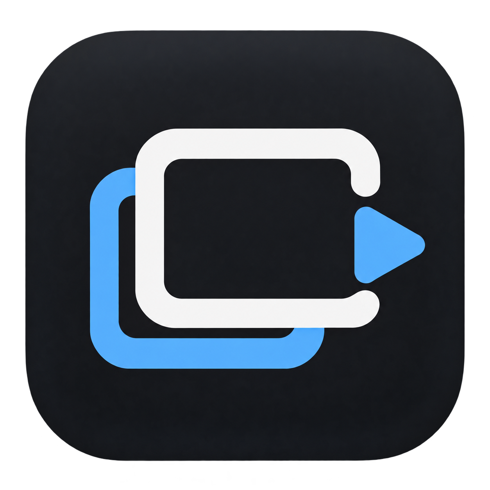

<p align="center">
  
</p>

<h1 align="center">FrameTrail</h1>

<p align="center">
  <b>录得清楚，剪得轻松，运镜自然。</b><br>
  Windows 11 原生的录屏与演示视频编辑工具。
</p>

<p align="center">
  
  
  
  
</p>

<p align="center">
  <a href="https://github.com/lucasx001/frametrail/releases/latest"><b>下载安装包</b></a>
  &nbsp;·&nbsp;
  <a href="#从源码构建">从源码构建</a>
  &nbsp;·&nbsp;
  <a href="https://github.com/lucasx001/frametrail/issues">反馈问题</a>
</p>

<p align="center">
  
</p>

## 功能

<table>
  <tr>
    <td width="50%" valign="top">
      <b>录制</b><br>
      显示器、窗口、自定义区域，或用 USB 数据线连接的 Android 手机。同时录制摄像头、麦克风和系统声音。
    </td>
    <td width="50%" valign="top">
      <b>剪辑</b><br>
      分割、裁剪、重排、0.25–4× 变速与恢复剪辑。连续缩略图和音频波形随时切换，时间线边界自动吸附。
    </td>
  </tr>
  <tr>
    <td valign="top">
      <b>运镜</b><br>
      点击自动跟随光标缩放与手动运镜；屏幕 3D 倾斜、透视与聚焦虚化；屏幕与摄像头开场动效。
    </td>
    <td valign="top">
      <b>画面</b><br>
      比例、画布裁切、留白、圆角、阴影、内置壁纸／渐变背景与窗口／浏览器／设备样机外框；贴图、遮挡与场景预设。
    </td>
  </tr>
  <tr>
    <td valign="top">
      <b>光标与摄像头</b><br>
      光标样式、平滑轨迹、点击反馈、静止隐藏与时间校准；摄像头实时预览、形状布局与出场动画。
    </td>
    <td valign="top">
      <b>导出</b><br>
      MP4（H.264／HEVC／AV1）或 M4A 音频；支持 1080p、1440p、4K 及 30／60 FPS。工程自动保存，随时继续编辑。
    </td>
  </tr>
</table>

<p align="center">
  
</p>

## 小技巧

- 录制前默认开启「点击自动缩放」，录制中的点击与光标操作会自动生成平滑运镜片段，进入编辑器即可直接预览和微调。
- 悬浮备忘录可以当提词器使用，支持自由拖动与字号调节，录制时不会被录进画面。
- 在时间线上用 <kbd>Ctrl</kbd>+<kbd>C</kbd>／<kbd>Ctrl</kbd>+<kbd>V</kbd> 复制效果片段，<kbd>Ctrl</kbd>+<kbd>Shift</kbd>+<kbd>V</kbd> 只粘贴同类属性。
- 双击预览画面或按 <kbd>F11</kbd> 可切换 4K 全屏预览；完整快捷键速查见「设置 → 编辑器」。

## 安装与开始使用

### 方式一：安装包 / 便携包直接安装（推荐）

1. 前往 [GitHub Releases](https://github.com/lucasx001/frametrail/releases/latest) 下载最新版本：
   - **安装版**：下载 `FrameTrail-X.Y.Z-x64-Setup.exe`，双击即可按当前用户完成安装。
   - **便携版**：下载 `FrameTrail-X.Y.Z-x64-Portable.zip`，完整解压到任意目录后运行 `FrameTrail.App.exe`。
2. 安装包已内置所需运行时，无需额外安装 .NET 或开发工具（支持 Windows 11 x64，22H2 及以上版本）。
3. 界面语言可在「设置 → 常规」中切换（跟随系统／简体中文／English），重启应用后生效。

> [!NOTE]
> 当前公开发行版尚未附带商业代码签名证书。首次运行安装程序或应用时，若遇到 Windows SmartScreen 提示“Windows 已保护你的电脑”，请点击 **更多信息 → 仍要运行**。请仅从本仓库官方 Releases 页面下载安装包。

### 方式二：从源码构建

<details>
<summary>克隆仓库到本地并自行编译启动（需要 Windows 11 x64、.NET 8 SDK、Visual Studio 2022 C++ 工具集与 CMake）</summary>

<br>

```powershell
# 1. 克隆仓库到本地
git clone https://github.com/lucasx001/frametrail.git
cd frametrail

# 2. 编译 Release 版本（包含 C++ 原生媒体引擎与 WinUI 3 桌面应用）
.\scripts\build.cmd -Configuration Release

# 3. 启动应用
.\scripts\run.cmd -Configuration Release
```

- 如果需要使用 **Android USB 手机录屏** 功能，可在首次构建前执行 `.\scripts\setup-android.cmd` 自动准备固定版本的 `adb` 与 `scrcpy-server` 运行组件，随后再运行上述构建与启动命令。
- 也可以在启动时直接指定打开某个已有工程：
  ```powershell
  .\scripts\run.cmd -Configuration Release -ProjectPath "C:\Videos\Demo.frametrailproject"
  ```
- 如需在本地打包生成便携包与 `Setup.exe` 安装程序：
  ```powershell
  .\scripts\package.cmd -OutputDirectory artifacts\packages\release -BuildInstaller
  ```

</details>

## 致谢与来源说明

- **参考项目**：FrameTrail 改编自 [laogou717](https://github.com/laogou717) 开发的 macOS 原生录屏工具 **[DogSC](https://github.com/laogou717/dogsc)**。本项目以 DogSC 的产品设计、界面布局、运镜规划与编辑领域模型为基础，采用 Windows 原生技术（WinUI 3 / C#、C++20、Windows.Graphics.Capture、WASAPI、Direct3D 11、Media Foundation）重写移植到 Windows 11。感谢原作者的开源分享！
- **内置壁纸**：编辑器内置的 18 张桌面壁纸来自 **[OpenScreen](https://github.com/siddharthvaddem/openscreen)**（作者 Siddharth Vaddem，MIT License）。
- **Android 录屏组件**：Android USB 录屏功能基于 **[scrcpy](https://github.com/Genymobile/scrcpy)**（Apache-2.0 License）与 Android SDK Platform-Tools。

## 开源协议

本项目源代码采用 [MIT License](LICENSE) 开源。各参考项目、随附字体与第三方运行组件的完整版权说明及许可证全文见 [第三方声明 (THIRD_PARTY_NOTICES.md)](THIRD_PARTY_NOTICES.md)。
