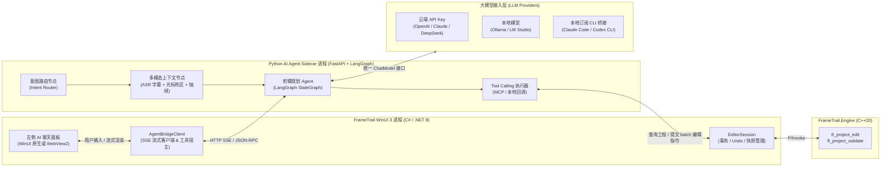
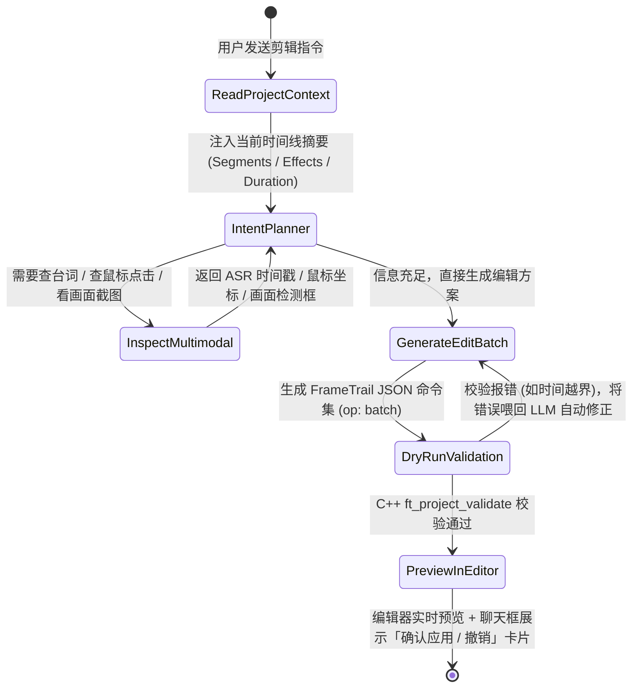

# FrameTrail 集成 AI 视频剪辑 Agent 技术调研与架构方案

> [!IMPORTANT]
> **核心结论先行**：
> 1. **FrameTrail 的现有架构极其适合接入 AI Agent**：项目底层已经将所有视频工程状态抽象为强类型的 JSON 快照（`ProjectSnapshot`），且 C++ 引擎已内置了原子的 JSON 编辑指令集（`split`、`trim`、`rate`、`effectUpsert`、`batch` 等）与完整的 Undo/Redo 栈。AI Agent **无需直接处理底层音视频像素流**，只需通过 **Tool Calling（工具调用）** 生成结构化 JSON 指令，即可实现**非破坏性、可实时预览、可一键撤销**的 AI 剪辑。
> 2. **LangChain / LangGraph 完全可以集成到本 Windows 原生应用中**：由于官方版 `LangGraph` 仅提供 **Python** 与 **TypeScript/JS** SDK（无官方 C# 版），最佳工程实践是采用 **“WinUI 3 原生宿主 + Python LangGraph 本地 Sidecar 服务（通过 HTTP SSE 或 MCP 协议通信）”** 的架构。这既能保持原生应用的流畅度，又能让你在项目中 100% 使用工业界最主流的 Python `LangChain` + `LangGraph` 技术栈（高度契合当前 AI Agent 岗位的招聘要求）。

---

## 一、 为什么 FrameTrail 现有架构天然适合做 AI 剪辑？

通过对当前代码库的盘点，FrameTrail 采用的是 **WinUI 3 (.NET 8 / C# 12) + C++20 原生引擎 (`FrameTrail.Engine`)** 架构。它具备三个让 AI Agent 事半功倍的底层设计：

### 1. 完全声明式的工程状态（Declarative Project Snapshot）
在 [`src/FrameTrail.Domain/ProjectSnapshot.cs`](../src/FrameTrail.Domain/ProjectSnapshot.cs) 与 [`src/FrameTrail.Domain/ProjectJson.cs`](../src/FrameTrail.Domain/ProjectJson.cs)（协议说明见 [`docs/schema.md`](schema.md)）中，整个视频工程被定义为一个不可变的 JSON 文档（`project.json`），包含：
- **`Segments`（切片序列）**：每个片段的源起点 `SourceStart`、时长 `SourceDuration`、变速倍率 `Rate`。
- **`Effects`（时间线视觉特效）**：支持 6 种核心特效（`zoom` 缩放运镜、`focus` 聚焦虚化、`mask` 遮挡打码、`tilt` 3D 倾斜、`sticker` 贴图、`intro` 开场动效），参数均为结构化 JSON（详见 [`native/FrameTrail.Engine/core/include/frametrail/core/effects.hpp`](../native/FrameTrail.Engine/core/include/frametrail/core/effects.hpp)）。
- **`Canvas` & `Editor`（画布与全局样式）**：比例、背景壁纸、圆角、阴影、设备样机外框、光标样式、分轨音量等。

### 2. 现成的 C++ 原子编辑指令总线与事务安全网
在 [`native/FrameTrail.Engine/core/src/editor.cpp`](../native/FrameTrail.Engine/core/src/editor.cpp) 和 [`src/FrameTrail.Workspace/EditorSession.cs`](../src/FrameTrail.Workspace/EditorSession.cs) 中，C# 调用 C++ 引擎的唯一修改入口是 `EditorSession.ExecuteAsync(object command)`。
- 它天然支持 **`op: "batch"`（原子批处理）**：AI 一次对话生成的多个剪辑动作可以打包为一个 `batch` 命令执行；如果其中任何一步参数越界，C++ 引擎 (`ft_project_validate`) 会直接拦截并回滚，绝不会损坏工程。
- 它天然接入 **Undo / Redo 历史栈**：AI 执行完剪辑后，用户如果不满意，按一次 `Ctrl+Z` 就能完整回退 AI 的所有修改。

### 3. 自带高精度“鼠标轨迹与点击事件流” (`PointerEvents`)
普通视频剪辑软件做 AI 剪辑最大的难点是“AI 看不懂画面里鼠标点了哪里”。而 FrameTrail 在录制时已经将所有鼠标移动和点击保存为 `events/*.jsonl`（见 [`src/FrameTrail.Workspace/AutomaticZoomPlanner.cs`](../src/FrameTrail.Workspace/AutomaticZoomPlanner.cs)），精确记录了每次点击的 `ticks` 时间戳和归一化坐标 `(x, y)`。这为 AI Agent 提供了极低成本的**空间+时间定位锚点**。

---

## 二、 核心调研：LangChain / LangGraph 如何集成到 Windows 原生应用？

### 1. 语言生态现状分析
- **FrameTrail 宿主层**：C# 12 / .NET 8 (`FrameTrail.App`, `FrameTrail.Workspace`) + C++20 (`FrameTrail.Engine`)。
- **LangChain / LangGraph 生态**：官方核心生态在 **Python**（最成熟，招聘市场认可度最高）和 **TypeScript/JS**。C# 社区虽然有非官方移植版 `LangChain.NET`，但缺乏完整的 `LangGraph` 状态图能力，而微软官方在 .NET 生态主推的是 `Microsoft.Extensions.AI` + `Semantic Kernel` / `Microsoft Agent Framework`。

为了同时满足**产品落地体验**和 **LangChain / LangGraph 技术栈诉求**，对比以下三种集成架构：

| 维度 | 方案 A：Python LangGraph Sidecar 架构（强烈推荐） | 方案 B：纯 .NET 8 原生 Agent 架构 | 方案 C：WebView2 + LangGraph.js 前端内嵌架构 |
| :--- | :--- | :--- | :--- |
| **核心框架** | **Python 官方 `LangGraph` + `LangChain` + `FastAPI`** | `Microsoft.Extensions.AI` + `Semantic Kernel` | TypeScript 版 `@langchain/langgraph` |
| **集成方式** | Python 独立子进程（Sidecar），通过本地 `HTTP SSE` 或 `stdio MCP` 与 WinUI 3 通信 | 直接作为 NuGet 包编译进 `FrameTrail.Workspace.dll` | 运行在左侧聊天窗口的 `WebView2` 或本地 Node 进程中 |
| **技术栈契合度** | ⭐⭐⭐⭐⭐ **100% 契合主流 AI Agent 岗位要求**（StateGraph、Checkpointer、Multi-Agent、LangSmith） | ⭐⭐⭐ 仅契合 .NET 企业级开发，缺少 Python LangGraph 生态工具 | ⭐⭐⭐⭐ 契合全栈 Agent 开发，但本地视频处理生态不如 Python |
| **多模态/AI 工具生态** | ⭐⭐⭐⭐⭐ 可直接在 Python 侧调用 `faster-whisper`（语音识别）、`OpenCV` 等丰富库 | ⭐⭐⭐ 需依赖 ONNX / Whisper.net P/Invoke 封装 | ⭐⭐ 无法直接高效处理本地音视频文件 |
| **打包与体积影响** | 安装包或插件包增加约 60~120MB（可通过“AI 组件按需安装”解决） | 几乎无体积增加（仅数 MB NuGet 依赖） | 仅增加前端静态资源（若不用 Node 后端则受限于 CORS） |

### 2. 推荐方案设计：WinUI 3 宿主 + Python LangGraph Sidecar + MCP 工具协议

> [!TIP]
> **参考项目现有设计**：FrameTrail 目前处理 Android 录屏组件（`adb` + `scrcpy-server`）时，采用的就是外置工具链 + C# 桥接器（[`src/FrameTrail.Workspace/AndroidBridge.cs`](../src/FrameTrail.Workspace/AndroidBridge.cs)）的模式。AI Agent 完全可以复用这一成熟的工程模式！



---

## 三、 三种大模型接入方式的实现方案

在 `LangChain` / `LangGraph` 中可以通过统一的 `BaseChatModel` 抽象层加上本地 CLI 适配器来支持**外部 API Key**、**电脑本地模型**以及**电脑本地已有订阅**：

### 1. 外部云端 API Key（BYOK 模式）
- **支持模型**：OpenAI (`gpt-4o`, `o3-mini`)、Anthropic (`claude-3-7-sonnet`, `claude-sonnet-4`)、Google Gemini、DeepSeek、OpenRouter 等。
- **技术实现**：
  - 在 Python 侧使用 `langchain-openai`、`langchain-anthropic`、`langchain-google-genai`，通过 `init_chat_model()` 动态实例化。
  - **安全性（Windows 原生特性）**：用户在 WinUI 3 设置界面填入的 API Key，使用 Windows **DPAPI (`Windows.Security.Credentials.PasswordVault`)** 加密存储在系统凭据管理器中，仅在会话启动时通过本地安全通道传递给 Agent 进程，绝不写入 `project.json`。

### 2. 电脑本地运行的大模型（Local LLM）
- **支持引擎**：**Ollama** (`http://localhost:11434/v1`)、**LM Studio** (`http://localhost:1234/v1`)、**vLLM**。
- **技术实现**：
  - 启动聊天窗口时，自动探测本地 `11434` 和 `1234` 端口，调用 `/api/tags` 或 `/v1/models` 列出用户电脑已下载的模型（如 `qwen2.5-coder:14b`、`llama3.3` 等支持 Tool Calling 的模型）。
  - 在 LangChain 中直接通过 `ChatOpenAI(base_url="http://localhost:11434/v1", api_key="ollama")` 零成本切换。

### 3. 调用电脑本地已有的“AI 订阅”（重点调研结论）

> [!WARNING]
> **合规与稳定性提醒**：不要通过逆向浏览器 Cookie 或抓取网页端私有接口的方式去调用 ChatGPT Plus / Claude Pro 网页版，这不仅违反服务条款（易导致用户封号），而且每次网页改版或触发人机验证都会导致功能瘫痪。

在桌面端软件中，复用用户本地已有订阅的**三种正规、可落地的技术方案**如下：

1. **方案 3.1：桥接本地已登录的官方 CLI Agent（最推荐，极客与开发者最爱）**
   - 许多拥有 Google Antigravity、Claude Pro/Max、ChatGPT Plus/Pro 或 GitHub Copilot 订阅的用户，电脑上已经登录了官方命令行工具：**Antigravity CLI (`agy`)**、**Claude Code (`claude`)**、**OpenAI Codex CLI (`codex`)** 或 **GitHub Copilot CLI**。
   - 这些 CLI 工具（以及 `google-antigravity` Python SDK）原生支持 **非交互式 JSON 流输出** 与本地 MCP 协议挂载（例如 `agy -p "指令" --output-format json --mcp-config frametrail-mcp.json` 或 `claude -p "指令" --output-format stream-json --mcp-config frametrail-mcp.json`）。
   - **对接方式**：将 FrameTrail 的编辑器操作封装为一个本地 **MCP Server (Model Context Protocol)**，当用户在聊天框选择“Antigravity CLI 本地订阅”或“Claude Code 本地订阅”时，直接通过子进程调用本地 `agy` / `claude` / `codex` CLI 并挂载 FrameTrail 的 MCP 工具集，即可直接消耗用户的订阅额度完成视频剪辑！
2. **方案 3.2：支持本地 OpenAI 兼容网关 / 代理端点**
   - 允许用户在模型配置中自定义 `Base URL`。如果用户在本地运行了统一订阅管理网关（如本地 OneAPI / LiteLLM / Copilot 转发服务），填入本地地址即可直接使用。
3. **方案 3.3：开放平台 OAuth PKCE 授权登录**
   - 对接支持第三方桌面应用 OAuth 登录的平台（如 **OpenRouter OAuth PKCE**），用户无需手动复制 API Key，点击“一键连接账号”即可在浏览器授权使用自己的账户额度。

---

## 四、 AI 视频剪辑 Agent 的工作流与工具设计（LangGraph 实战）

大模型本身无法直接实时读取几个 GB 的 MP4 视频流。为了让 AI 听懂诸如*“把前面讲错的那段删掉，并在我点击‘导出’按钮的地方加个 2 倍放大特效”*这样的自然语言指令，需要构建一个 **“多模态感知索引 + LangGraph 状态机 + 原生命令工具集”**。

### 1. 视频多模态感知层（让 AI “看懂”和“听懂”视频）
当用户在编辑器中打开工程并唤醒 AI 助手时，后台可按需构建轻量级结构化索引：
1. **音频转字幕时间轴（ASR 索引）**：
   - 使用 `faster-whisper`（本地 CPU/GPU）或云端 Whisper API，提取麦克风轨（`MediaKind.Microphone`）和系统音轨（`MediaKind.SystemAudio`）的带时间戳文本：
     ```json
     [
       {"startSec": 0.5, "endSec": 3.2, "text": "大家好，今天演示一下如何导出视频"},
       {"startSec": 3.2, "endSec": 5.8, "text": "呃……等一下我说错了重来"},
       {"startSec": 6.0, "endSec": 9.5, "text": "首先我们点击右上角的导出按钮"}
     ]
     ```
2. **鼠标点击与焦点热区索引（复用 `PointerEvents`）**：
   - 直接解析工程目录中的 `events/*.jsonl`，提取所有点击事件（`kind: 1` 左键 / `kind: 3` 右键）的时间点与归一化坐标 `(x, y)`。
3. **按需关键帧视觉抽帧（On-demand VLM Frame Inspection）**：
   - 当用户指令涉及视觉内容（如*“把画面里的手机号打码”*或*“找到弹出报错窗口的那一秒”*），Agent 调用 `inspect_video_frames(start_sec, end_sec, fps=1)` 工具，复用 [`src/FrameTrail.App/EditorMediaCache.cs`](../src/FrameTrail.App/EditorMediaCache.cs) 抽取几张低分辨率截图传给多模态大模型（GPT-4o / Claude Sonnet），获取精确的时间范围和矩形坐标 `NormalizedRect`。

### 2. LangGraph 状态图（StateGraph）设计
在 Python 侧使用 `LangGraph` 构建一个具备 **规划（Plan）→ 检索感知（Inspect）→ 工具执行（Act）→ 校验自修复（Verify）→ 人类确认（Human-in-the-loop）** 的多节点状态图：



> [!TIP]
> **面试与简历亮点**：上面这个 `DryRunValidation`（利用 C++ 引擎的 `EngineSession.ValidateProject` 做确定性校验，失败则触发 LangGraph 条件边 `conditional_edges` 自修复重试）是工业界最推崇的 **“LLM + 确定性编译器/引擎校验回路（Verifier Loop）”** 模式！

### 3. Agent 工具集（Tools）与 FrameTrail 原生引擎映射表

将 [`native/FrameTrail.Engine/core/src/editor.cpp`](../native/FrameTrail.Engine/core/src/editor.cpp) 中的能力封装为 LangChain `@tool` 函数（自动将秒数转换为 `10_000_000` Ticks）：

| Agent 工具名称 (`@tool`) | 作用描述（供 LLM 理解） | 映射的 FrameTrail 原生命令 (`EngineSession.Edit`) |
| :--- | :--- | :--- |
| `get_timeline_overview()` | 获取当前工程总时长、所有片段(`Segments`)、已有特效(`Effects`)及画布设置 | 读取 `EditorSession.Snapshot` & `EditorSession.Timeline` |
| `search_transcript_and_clicks(query)` | 搜索口播字幕时间戳及对应时间段的鼠标点击坐标 `(x, y)` | 读取 ASR 缓存 + 解析 `PointerEvents` (`events/*.jsonl`) |
| `inspect_frames(start_sec, end_sec)` | 抽取指定时间段的画面帧供多模态模型识别 UI 元素或敏感信息位置 | 调用 `EditorMediaCache` 导出 JPEG 缩略图序列 |
| `cut_time_range(start_sec, end_sec)` | 剪除指定时间段的视频（如删除口误、静音段） | 组合 `op: "split"` + `op: "delete"` 打包进 `op: "batch"` |
| `change_segment_speed(segment_id, rate)` | 将某一段视频加速或慢放（支持 `0.25x` ~ `4x`） | `{"op": "rate", "segmentId": ..., "numerator": ..., "denominator": ...}` |
| `add_zoom_effect(start_sec, end_sec, scale, focus_x, focus_y)` | 在指定时间段添加镜头推进/放大特效（可指定聚焦坐标或自动跟随鼠标） | `{"op": "effectUpsert", "effect": {"kind": "zoom", ...}}` |
| `add_spotlight_or_blur(start_sec, end_sec, rect, mode)` | 添加背景虚化聚焦（`focus`）或敏感信息打码遮挡（`mask`） | `{"op": "effectUpsert", "effect": {"kind": "focus" \| "mask", ...}}` |
| `add_3d_tilt_effect(start_sec, end_sec, angle_x, angle_y)` | 在指定片段添加 3D 屏幕透视倾斜特效 | `{"op": "effectUpsert", "effect": {"kind": "tilt", ...}}` |
| `update_canvas_style(aspect_ratio, padding, corner_radius, frame_style)` | 修改画布比例（如改成 `9:16` 竖屏短视频）、背景留白、圆角或套壳样机 | `{"op": "settings", "canvas": ..., "editor": ...}` |

---

## 五、 编辑器左侧 AI 聊天窗口 UI 改造方案

查看现有的 [`src/FrameTrail.App/EditorWindow.xaml`](../src/FrameTrail.App/EditorWindow.xaml)，目前编辑器主体区域 `EditorBody` 采用的是三列网格布局：
- `Column 0` (`Width="*"`): 中央视频预览舞台 `PreviewStage` 与播放控制条
- `Column 1` (`Width="1"`): 分割线
- `Column 2` (`Width="340"`): 右侧属性检查器面板（画面、光标、摄像头、音频、片段设置）

### UI 布局嵌入方式
只需将 `EditorWindow.xaml` 的 `EditorBody` 扩展为 **左（AI 助手，可折叠 320px）— 中（预览舞台 `*`）— 右（属性检查器 340px）** 布局：
1. **顶部标题栏入口**：在顶部栏增加一个 `✨ AI 剪辑助手` 切换按钮（快捷键如 `Ctrl+J` 或 `Ctrl+L`），点击后平滑展开左侧聊天列。
2. **左侧聊天窗口的四大核心 UI 模块**：
   - **顶部模型切换栏**：下拉选择模型源（`OpenAI API` / `Claude API` / `Ollama 本地模型` / `Claude Code 本地订阅`）+ 状态指示灯 + API Key 设置弹窗入口。
   - **中部消息流与操作卡片区**：
     - 支持流式输出 AI 回复。
     - **Tool 执行状态芯片（Action Chips）**：当 AI 调用工具时，实时显示如 `🔍 正在定位“点击导出”的鼠标坐标 (00:14.20)...`、`✂️ 已生成 2 处运镜特效`。
     - **预览确认卡片**：利用 `EditorSession.BeginTransaction()` / `PreviewCommand()` 实时在中央画布渲染预览效果，卡片上提供 **[✓ 确认应用]** 与 **[↺ 撤销修改]** 按钮。
   - **快捷指令气泡（Prompt Chips）**：针对录屏场景预设高频一键指令，如：`[✨ 自动剪掉静音和停顿]`、`[🔍 在每次关键点击处添加 1.8x 放大]`、`[📱 一键改为 9:16 竖屏抖音风格]`、`[🛡️ 检测画面敏感信息并打码]`。
   - **底部多模态输入框**：支持直接输入自然语言，且支持点击“插入当前时间点”（自动把播放头所在的 `00:12.40` 填入输入框，方便用户说*“在 `@00:12.40` 这里加个聚焦虚化”*）。

---

## 六、 推荐完整技术栈清单与分阶段落地路线

### 1. 完整技术栈汇总
- **桌面端 UI 与宿主层**：WinUI 3 (.NET 8 / C# 12)、`CommunityToolkit.WinUI`（Markdown/流式消息渲染，或使用 `WebView2` 承载轻量聊天前端）、Windows `PasswordVault`（API Key 加密存储）。
- **AI Agent 编排层（Python Sidecar）**：
  - **核心框架**：`LangGraph`（构建带状态持久化和条件校验回路的 Agent 工作流）+ `LangChain Core`（统一模型接口与 `@tool` 定义）。
  - **通信服务**：`FastAPI` + `SSE (Server-Sent Events)`（实现打字机流式输出与工具调用状态推送）+ `MCP (Model Context Protocol)`（供本地订阅 CLI 接入）。
- **多模态感知层**：
  - **语音识别 (ASR)**：`faster-whisper`（本地离线提取时间戳字幕）或 OpenAI Whisper API。
  - **视觉与轨迹**：FrameTrail 原生 `PointerEvents` 解析器 + `EditorMediaCache` 关键帧抽帧。
- **底层执行引擎**：FrameTrail C++20 `ft_project_edit` (`op: "batch"`) + `EditorSession` Undo/Redo 事务机制。

### 2. 分阶段演进路线（MVP → 进阶）
- **Phase 1（MVP：跑通“对话改工程”闭环，1~2 周）**
  1. 在 `EditorWindow.xaml` 左侧新增可折叠 AI 聊天面板 UI 与模型配置弹窗（支持填写 OpenAI/Claude/DeepSeek API Key 及连接本地 Ollama）。
  2. 搭建 Python `LangGraph` 服务，打通与 C# `EditorSession.ExecuteAsync` 的桥接。
  3. 封装第一批无需 ASR 的核心工具：`get_timeline_overview`、`search_pointer_clicks`、`add_zoom_effect`、`add_spotlight_or_blur`、`add_3d_tilt_effect`、`change_segment_speed`、`update_canvas_style`。此时用户已经可以通过对话让 AI 自动加运镜、改画布、调倍速、按时间点剪辑。
- **Phase 2（多模态感知升级：听懂台词 + 看懂画面，2~3 周）**
  1. 接入 `faster-whisper` / Whisper API 字幕提取，支持“按台词内容剪辑”、“一键剔除口误与长停顿”。
  2. 接入关键帧抽帧工具 `inspect_frames`，支持让多模态大模型看图定位 UI 元素位置并自动添加 `mask`（打码）或 `focus`（聚光灯）。
- **Phase 3（本地订阅 CLI 桥接与 Human-in-the-loop 增强）**
  1. 将编辑器工具集暴露为标准本地 MCP Server，支持一键调用用户本地已登录的 Claude Code / Codex CLI 订阅。
  2. 在 `LangGraph` 中启用 `MemorySaver / SqliteSaver` Checkpointer，支持多轮对话微调上次生成的特效参数。
